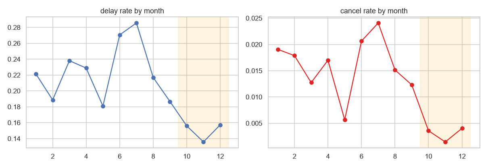
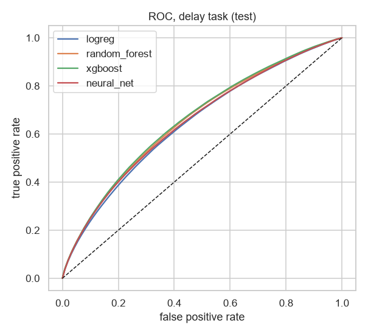
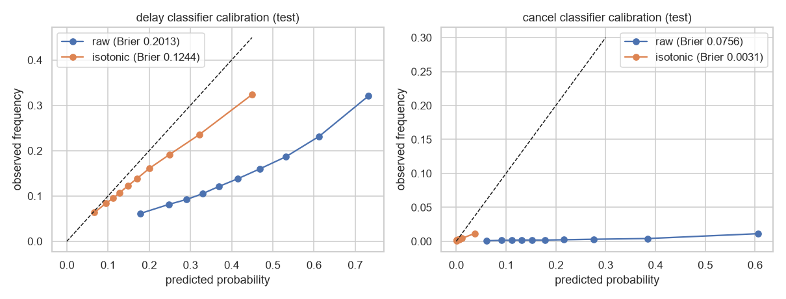
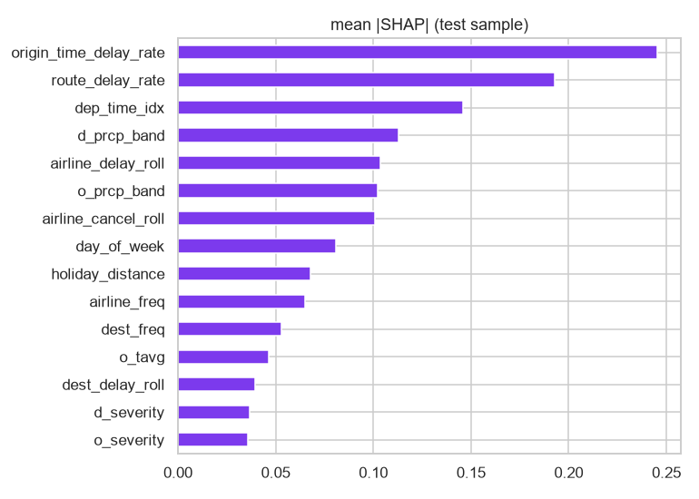

# Flight Delay and Cancellation Prediction

A full-stack machine-learning web app (Sem 7 capstone). Enter a US flight, or look one up by flight number, and get the **calibrated
probability of a delay (15+ min) or a cancellation**, a typical delay length, and the **five factors behind the score**. It also offers live
status and weather, a searchable 2023 history, airport risk map, model comparison, saved searches with email alerts, and bulk CSV scoring.

> **New to this repo, or setting it up on another PC? Read [START-HERE.md](START-HERE.md) first.** It covers setup, git/GitHub pitfalls, an error decision tree and the one open issue.

Trained on **6.8 million US flights from 2023** (Kaggle `bordanova/2023-us-civil-flights-delay-meteo-and-aircraft`) and evaluated on months the models never saw.

| | |
|---|---|
| **Client** | React 18, Vite, Tailwind 3.4, TanStack Query, Recharts, react-leaflet (OpenStreetMap), PWA |
| **API** | Node 20, Express, Mongoose, JWT, zod, rate limiting, node-cron |
| **ML service** | Python 3.11, FastAPI, XGBoost, SHAP, DuckDB over Parquet |
| **Data** | MongoDB (app data only), live data from AviationStack and Open-Meteo with cache, quota guard and demo fallback |

## Results (honest, time-split test on Oct-Dec 2023)

| Model | ROC AUC | F1 | Notes |
|---|---|---|---|
| Logistic regression | 0.646 | 0.317 | baseline |
| Random forest | 0.657 | 0.325 | |
| **XGBoost (deployed)** | **0.661** | **0.330** | Brier 0.124 after isotonic calibration (0.201 before) |
| Neural network | 0.651 | 0.321 | |
| XGBoost cancellation model | 0.706 | 0.061 | cancellations are rare (0.3% in the test months) |

All four model families land within 0.015 AUC: the limit is the information in the data (no clock time, no aircraft state), not the algorithm.
A random 80/20 split would have reported AUC 0.745; we report the strict number. Full discussion in [docs/ml-methodology.md](docs/ml-methodology.md).

| | |
|---|---|
|  |  |
|  |  |

## Quick start (Windows; macOS/Linux use `bash scripts/setup.sh`)

```powershell
# prerequisites: Node 20+, Python 3.11, Git   (winget install OpenJS.NodeJS.LTS / Python.Python.3.11 / Git.Git)
git clone <repo-url> "New project" ; cd "New project"
powershell -ExecutionPolicy Bypass -File scripts\setup.ps1       # venv + npm ci + .env files with generated secrets + doctor
powershell -ExecutionPolicy Bypass -File scripts\start-dev.ps1   # MongoDB + ML service + API + client
# open http://localhost:5173
```

No keys needed: without an AviationStack key the app runs on built-in demo flights (clearly badged) plus real Open-Meteo weather.
The Insights / History / Risk-map pages need the processed parquet (see [setup guide](docs/setup-guide.md) section 4); predictions do not.

Something not working? `node scripts/doctor.mjs` diagnoses the machine and prints a fix for each problem; the full catalogue is
[docs/TROUBLESHOOTING.md](docs/TROUBLESHOOTING.md).

## Docker

```powershell
copy .env.example .env          # set JWT_SECRET (32+ chars) and ML_INTERNAL_KEY (16+ chars)
docker compose up --build       # http://localhost:8080
```

## Repository layout

```
client/        React app                         server/       Express API (+ tests, scripts)
ml-service/    FastAPI serving, training pipeline, notebooks, committed model artifacts
data/          raw CSVs + processed parquet (git-ignored), external lookups (committed)
docs/          documentation (below)             scripts/      setup, start-dev, doctor, pack-data
.github/       CI (3 test suites + image builds) and deploy workflows
```

## Tests

| Suite | Count | Run |
|---|---|---|
| ML service (API contract, auth, SHAP additivity, train/serve parity, fail-fast loading) | 49 | `cd ml-service; venv\Scripts\python -m pytest -q` |
| Node API (auth, cache and stale-if-error, quota atomicity, rate limits, bulk CSV, alerts, admin) | 87 | `cd server; npm test` |
| Client (theme, auth guards, accessibility of components, forms, CSP drift guard) | 67 | `cd client; npm test` |

The Node tests run against a real in-memory MongoDB with stub servers for the ML service, AviationStack and Open-Meteo, so they need no network or keys.

## Documentation

| Document | What it covers |
|---|---|
| [architecture.md](docs/architecture.md) | components, data flow, failure behaviour, security model, caching |
| [api-spec.md](docs/api-spec.md) | every endpoint of the Node API and the ML service |
| [db-schema.md](docs/db-schema.md) | the six MongoDB collections |
| [ml-methodology.md](docs/ml-methodology.md) | data, leakage rules, split, features, models, results, limitations |
| [setup-guide.md](docs/setup-guide.md) | install, run, test, retrain, Docker, configuration |
| [deployment-guide.md](docs/deployment-guide.md) | Atlas, Render, Vercel, GitHub Actions, verification checklist |
| [TROUBLESHOOTING.md](docs/TROUBLESHOOTING.md) | symptom to fix tables, new-PC setup, moving the project, reset recipes |
| [CONTEXT.md](docs/CONTEXT.md) | locked decisions and the build log with every deviation |
| [team-contributions.md](docs/team-contributions.md), [project-report/](docs/project-report/report-outline.md) | team record and report outline |

## Limitations

The model cannot see the aircraft's live state or the exact departure time, so it separates riskier flights from safer ones rather than forecasting
precisely; the delay-minutes estimate is only slightly better than guessing the median. The UI says so wherever a prediction is shown.
