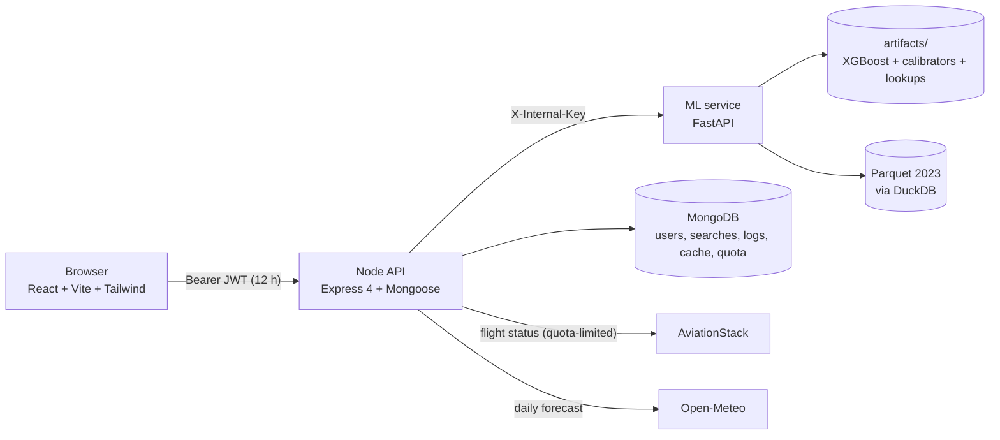
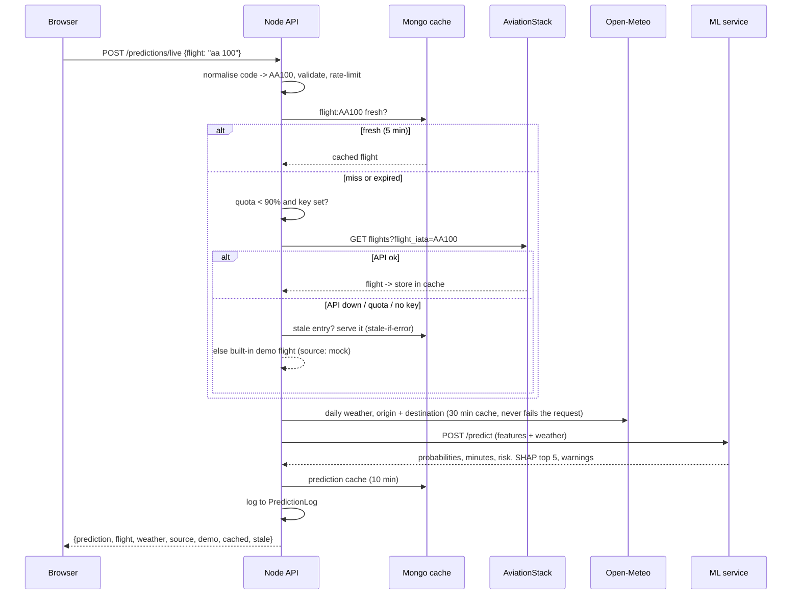

# Architecture

## System overview



| Part | Tech | Deploy | Owns |
|---|---|---|---|
| `client/` | React 18, Vite 5, Tailwind 3.4, TanStack Query 5, Recharts, react-leaflet | Vercel (or nginx container) | UI, theme, charts, map |
| `server/` | Node 20, Express 4, Mongoose 8, JWT, zod, helmet, node-cron | Render | auth, live-data orchestration, cache, quota, logging, alerts |
| `ml-service/` | Python 3.11, FastAPI, XGBoost, SHAP, DuckDB | Render / HF Spaces | prediction, explanation, historical analytics |
| MongoDB | Atlas free (512 MB) | Atlas | application data only |

## The one idea: who is allowed to know what

- The **browser** only knows the Node API and holds a JWT.
- The **Node API** is the only component that talks to the internet (AviationStack, Open-Meteo). It caches, counts quota, falls back to demo data, and sends the ML service a *complete, validated payload* (Decision 8).
- The **ML service** is a **pure function**: features in, prediction out. No network calls, no database, guarded by a shared secret. That makes it trivial to test and to swap.

## Live prediction flow



## Reliability design (what happens when things fail)

| Failure | Behaviour |
|---|---|
| AviationStack key missing / quota at 90% / API error | cached copy (even expired) -> built-in demo flights, flagged `source: mock`, UI badge "Demo data" |
| Open-Meteo down or out of range | prediction continues; the ML service fills typical weather and returns a warning |
| ML service down | cached prediction if one exists (stale), else `503 ML_UNAVAILABLE`; `/health` reports `degraded` |
| ML artifacts missing or mismatched | the ML service **refuses to start** (fails loudly, never serves a wrong model) |
| Parquet data missing | predictions fine; analytics routes answer 503 with a clear message |
| MongoDB down | `/health` is `down` (503); log-write failures never fail a prediction |
| Expired JWT | 401, the client clears it, shows "Session expired" and returns the user to where they were |

## Security model

- Single JWT in `Authorization: Bearer`, HS256 pinned (no `alg: none`), 12 h, role read from the DB on each request (Decision 2). Trade-off: localStorage is readable by XSS, so: strict CSP (the only inline script is allowed by hash), no `dangerouslySetInnerHTML` (lint rule), all input validated with zod, helmet on the API.
- Passwords: bcrypt cost 12, login timing and message identical for unknown email vs wrong password, per-IP rate limit on auth routes.
- ML service: shared `X-Internal-Key` with constant-time comparison on every route; not published to the internet in docker-compose.
- Other users' resources return 404 (no existence leak); a client cannot set its own role.
- Uploads: `.csv` only, 512 KB, in memory, spreadsheet-formula-safe on export. SQL is parameterised.
- Secrets only in env vars; `.env` files git-ignored; the AviationStack key is never logged (axios errors are not dumped).

## Caching (Decision 3)

| Kind | Fresh for | Kept for stale-if-error | Key |
|---|---|---|---|
| flight | 5 min | +24 h | `flight:AA100`, `route:JFK-LAX` |
| weather | 30 min | +24 h | `weather:JFK:2026-10-27` |
| prediction | 10 min | +1 h | `pred:<hash of airline, route, date+hour, distance, weather>` |
| analytics | 24 h | +7 d | `analytics:overview`, `hist:<hash>` ... |

Concurrent identical misses share one upstream call (single flight). Keys are normalised so `AA100` = `aa 100` = `AA-100`.

## Frontend structure

Providers: `QueryClientProvider > ThemeProvider > BrowserRouter > AuthProvider > App`. 14 lazy-loaded pages, shared common components
(`Button, Card, Input, Select, Modal, DataTable, Toast, Tabs, ...`), charts take colours from the resolved theme because Recharts ignores Tailwind `dark:`.
The URL is the source of truth for searches, so they are shareable and saved-search "Run" is a plain link.

## Folder map

```
client/       React app (src/{api,components,context,hooks,layouts,lib,pages,routes,utils}, tests/)
server/       Express API (src/{config,controllers,middleware,models,routes,services,validators,jobs,utils,data}, tests/, scripts/)
ml-service/   app/ (FastAPI serving), training/ (pipeline), notebooks/, artifacts/ (committed), tests/
data/         raw CSVs (git-ignored), processed/ (git-ignored parquet), external/ (committed airports, holidays)
docs/         this documentation, CONTEXT.md (decisions + build log), TROUBLESHOOTING.md
scripts/      setup, start-dev, doctor, pack-data
.github/      CI and deploy workflows
```

## Decisions

The 12 locked decisions and every deviation made during the build are in [`CONTEXT.md`](CONTEXT.md) (sections 4, 15).
